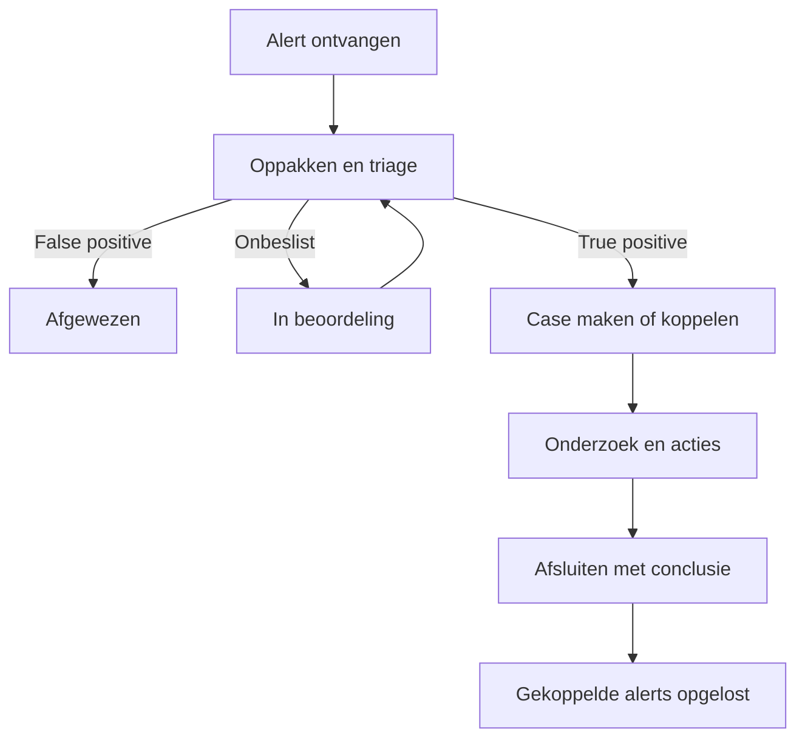
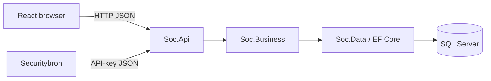
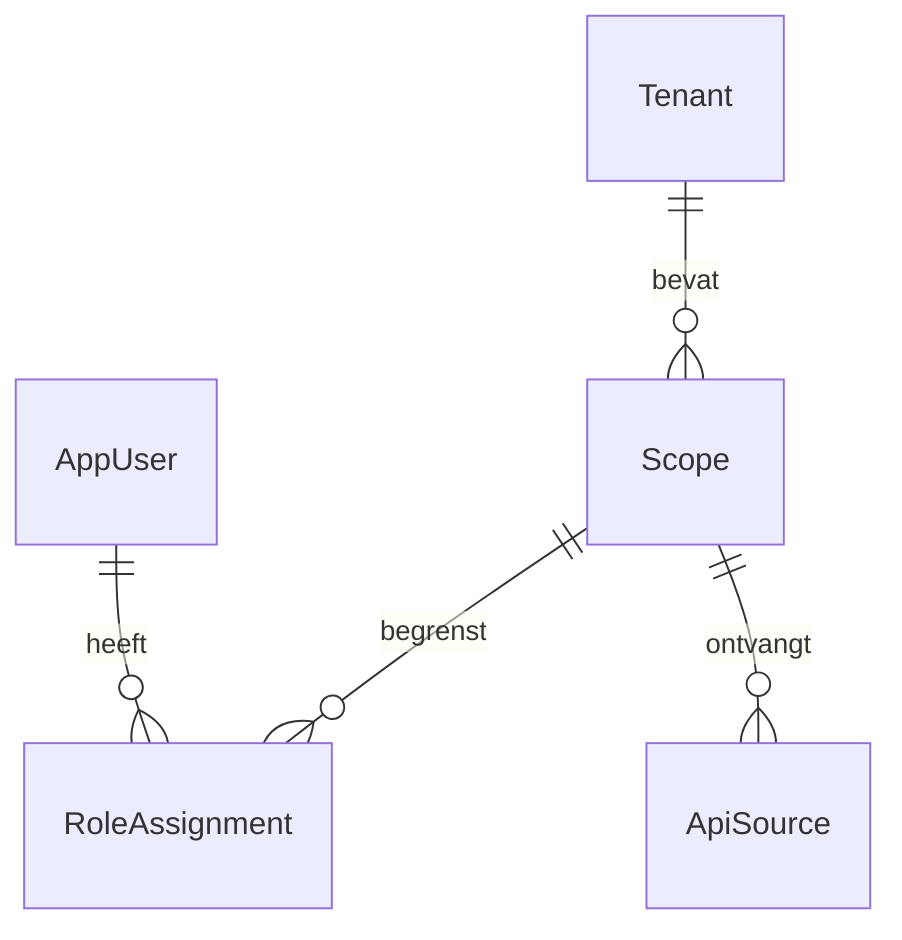
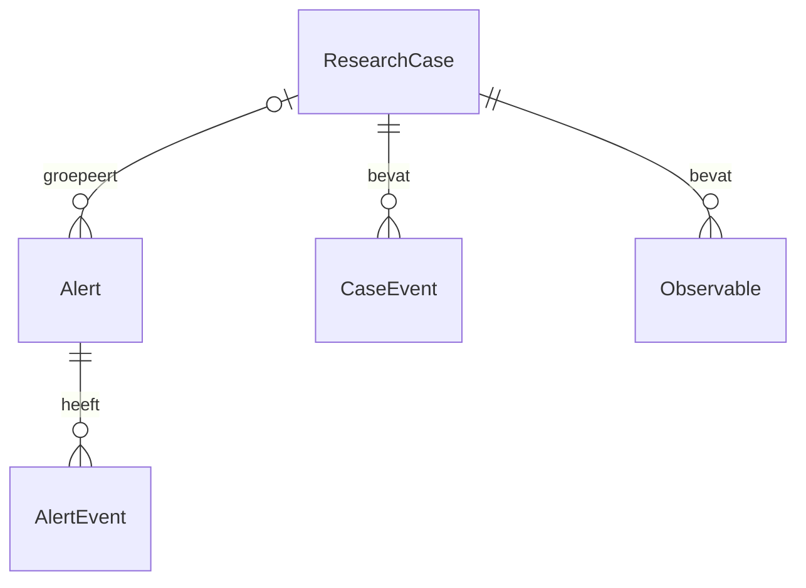

# SOC3 Management

SOC3 Management is een webapplicatie voor een Security Operations Center (SOC) van een Managed Security Service Provider (MSSP). Het systeem ontvangt beveiligingsmeldingen, ondersteunt triage en onderzoek, schermt klantinformatie af en registreert relevante acties.

Dit is de demonstratie-MVP van het SE3-project: React, ASP.NET Core en een echte SQL Server-database. De oorspronkelijke groepsrepository blijft ongewijzigd. Deze versie is geen letterlijke merge van de oorspronkelijke branches.

## Inhoud

- [1. Installatie](#1-installatie)
- [2. Gebruikers en rollen](#2-gebruikers-en-rollen)
- [3. Functionele werking](#3-functionele-werking)
- [4. API-aanlevering](#4-api-aanlevering)
- [5. Technische architectuur](#5-technische-architectuur)
- [6. Database](#6-database)
- [7. API-contracten](#7-api-contracten)
- [8. Beveiliging](#8-beveiliging)
- [9. Ontwikkelen en testen](#9-ontwikkelen-en-testen)
- [10. Opdrachtgever en eisenmatrix](#10-opdrachtgever-en-eisenmatrix)
- [11. Demonstratie en vervolg](#11-demonstratie-en-vervolg)

## 1. Installatie

Vereisten: Git, toegang tot de private repository, Docker Desktop met Compose en internet voor dependencies. Node.js 22.12+ (24 aanbevolen) is nodig voor lokaal frontendwerk en de smoketest.

Open Docker Desktop en voer uit:

```bash
git clone https://github.com/TeunHSytrius/SOC3-Project.git
cd SOC3-Project
docker compose up --build -d
```

Open [http://localhost:8081](http://localhost:8081).

Bij een bestaande lokale kopie:

```bash
git pull --ff-only origin main
docker compose up --build -d
```

SQL Server moet eerst gereed zijn. De backend probeert opnieuw te verbinden en initialiseert bij een lege demodatabase het platform, de klantschema's en fictieve gegevens. De eerste start kan daardoor tijdelijk onbereikbaar zijn.

```bash
docker compose ps
curl http://localhost:8081/api/v1/health
```

Verwachte healthcheck: `{"status":"ok"}`.

| Onderdeel | Configuratie |
| --- | --- |
| Website en API op host | 127.0.0.1:8081 |
| ASP.NET Core in container | 8080 |
| SQL Server binnen Docker | 1433 |
| SQL-data | volume socsql |
| Data Protection-sleutels | volume sockeys |

SQL Server wordt niet rechtstreeks op de host gepubliceerd.

Stoppen en logs bekijken:

```bash
docker compose down
docker compose logs --tail=100 app sqlserver
```

Bekijk de logs vóór het verwijderen van de containers als er een opstartfout optreedt. Normaal stoppen bewaart de volumes. Alleen in een wegwerp-demoomgeving kan `docker compose down -v` worden gebruikt om alle demodata en sleutels te wissen. Dit is destructief en mag niet op echte data worden toegepast.

Op Apple Silicon draait het SQL Server-image via amd64-emulatie. Bij problemen: controleer Docker Desktop of gebruik een afzonderlijke x64 SQL Server-testomgeving. Er is geen SQLite-fallback.

## 2. Gebruikers en rollen

Initiële demoaccounts; wachtwoord voor alle accounts: `Demo2026!`.

| Account | Rol | Initiële toegang |
| --- | --- | --- |
| analist@soc.demo | Analist | Alle drie demoklanten |
| senior@soc.demo | Senior analist | Alle drie demoklanten; heropenen van alerts |
| beheerder@soc.demo | Beheerder | Platformbeheer en audit |
| klant@soc.demo | Klant | Vrijgegeven cases van Northstar Finance |
| accountmanager@soc.demo | Accountmanager | Vrijgegeven cases van Northstar Finance en Delta Logistics |

| Functionaliteit | Analist | Senior | Beheerder | Klant | Accountmanager |
| --- | --- | --- | --- | --- | --- |
| SOC-dashboard en alerts | Ja | Ja | Nee | Nee | Nee |
| Alert oppakken, triage en escalatie | Ja | Ja | Nee | Nee | Nee |
| Afgewezen/opgeloste alert zonder case heropenen | Nee | Ja | Nee | Nee | Nee |
| Onderzoeken beheren | Ja | Ja | Nee | Nee | Nee |
| Vrijgegeven onderzoeken bekijken | Ja | Ja | Nee | Ja | Ja |
| Klantreactie toevoegen | Via onderzoek | Via onderzoek | Nee | Ja | Nee |
| Klanten, accounts en API-sleutels beheren | Nee | Nee | Ja | Nee | Nee |
| Auditlog bekijken | Nee | Nee | Ja | Nee | Nee |
| Eigen 2FA instellen | Ja | Ja | Ja | Ja | Ja |

Klant- en scopetoewijzingen begrenzen operationele toegang. Beheerders krijgen niet automatisch toegang tot onderzoeksinhoud. De voorgestelde procesrollen van de opdrachtgever zijn nog niet volledig geïmplementeerd; zie hoofdstuk 10.

### Gebruikersbeheer

Log in als beheerder en open **Gebruikers & rollen**. Maak een gebruiker aan of gebruik **Bewerken** bij een ander account. Naam, e-mailadres, rol, klanttoegang, actieve status en optioneel een nieuw wachtwoord kunnen worden gewijzigd.

Een leeg wachtwoordveld behoudt het huidige wachtwoord. Bij een reset gelden de Identity-regels: minimaal acht tekens, hoofdletter, kleine letter, cijfer en speciaal teken. Het e-mailadres is ook de gebruikersnaam. Dubbele e-mailadressen worden geweigerd. Een klantaccount moet precies één organisatie hebben. Een account heeft momenteel één applicatierol, maar kan aan meerdere klanten worden gekoppeld als die rol dit toestaat.

Deactivering blokkeert inloggen en API-toegang; historische gegevens blijven behouden. Heractivering is mogelijk. Het eigen beheerdersaccount kan via dit beheerformulier niet worden gewijzigd. De ingestelde 2FA blijft bij accountbewerking behouden. Er is geen hard-delete van accounts.

### Klantenbeheer

Een beheerder kan klanten aanmaken, hun naam wijzigen, deactiveren en heractiveren. Een nieuwe klant krijgt een eigen SQL-schema met standaard scope Algemeen. Hernoemen verandert de tenant-GUID en schemanaam niet. Deactivering blokkeert nieuwe ingest en operationele wijzigingen; bevoegde gebruikers kunnen historische informatie behouden en raadplegen.

## 3. Functionele werking

### Dashboard

Het dashboard toont open alerts, actieve cases, SLA-risico's, overschrijdingen, prioriteitsverdeling, SLA-prestaties, FIFO-wachtrij en actieve onderzoeken. De klantfilter beperkt de getoonde resultaten. Vernieuwen haalt actuele gegevens op; er is nog geen realtime push.

### Alerts

- Handmatig toevoegen of ontvangen via de ingest-API.
- Zoeken op onder meer titel, nummer, bron, eigenaar en klant; filteren op klant, status en prioriteit.
- Details bekijken: bron, omschrijving, ontvangst, deadline, eigenaar, triage en geschiedenis.
- Oppakken, triage vastleggen met motivatie, afwijzen of escaleren.
- Senior analist: afgewezen of opgeloste alert zonder case heropenen.

### Cases en klantportaal

- Case aanmaken vanuit een true-positive-alert of koppelen aan een bestaande open case in dezelfde klant en scope.
- Status wijzigen, eigenaar overdragen, notities, acties, observables en bewijsreferenties toevoegen.
- Case vrijgeven aan de klant; geschikte tijdlijnitems klantzichtbaar maken.
- Klant kan reageren op een open vrijgegeven case; accountmanager kan deze lezen.
- Afsluiten vereist een conclusie en lost gekoppelde alerts op.

Bewijsreferenties zijn tekstueel; bestandsuploads ontbreken. Observables en bewijsreferenties zijn intern; notities en acties kunnen expliciet zichtbaar gemaakt worden. De server filtert externe case-responses.



Alertstatussen: New, PendingReview, UnderReview, Escalated, Dismissed en Resolved. Casestatussen: Open, UnderInvestigation, UnderReview, Resolved en Closed.

### SLA

| Prioriteit | Demo-SLA eerste behandeling |
| --- | --- |
| Low | 48 uur |
| Moderate | 24 uur |
| High | 8 uur |
| Urgent | 4 uur |
| Immediate | 1 uur |

De deadline wordt bij ontvangst berekend. De eerste behandeling wordt geregistreerd bij een operationele alertactie. Een onbehandelde open alert met maximaal twee uur resterende tijd geldt als risico. SLA-prestatie vergelijkt eerste behandeling en deadline. Deze waarden zijn demonstratieafspraken, geen definitieve contractuele SLA's. SLA-instellingen per klant en case-SLA's ontbreken nog.

### Account, API-sleutels en audit

Mijn account toont profielgegevens en biedt TOTP-setup via QR-code, handmatige sleutel en acht herstelcodes. Een beheerder genereert en trekt API-sleutels in per bron en klant/scope. De volledige sleutel is alleen bij creatie zichtbaar. De auditlog combineert platform- en klantactiviteiten.

De seeddata bevat drie fictieve klanten (Northstar Finance, Delta Logistics, Atlas Health), acht alerts en één lopende case. De gegevens blijven bij een normale herstart behouden.

## 4. API-aanlevering

Er is een echte ingest-API, maar geen live koppeling met Sentinel, Defender of Splunk. De namen van deze bronnen in de demodata zijn fictieve labels.

Maak als beheerder onder API-sleutels een sleutel voor Northstar Finance. Stuur daarna een fictieve melding via de terminal:

```bash
read -rs 'SOC_KEY?API-sleutel: ' # zsh op macOS
curl -X POST http://localhost:8081/api/v1/ingest/alerts \
  -H "X-API-Key: $SOC_KEY" \
  -H 'Content-Type: application/json' \
  -d '{"title":"Testmelding","description":"Fictieve melding voor de demo","priority":"High"}'
unset SOC_KEY
```

Verwacht HTTP 201. Vernieuw daarna het dashboard als analist. De API-key bepaalt server-side klant en scope; waarden uit de requestbody mogen dit niet overschrijven. Ongeldige of ingetrokken sleutels geven HTTP 401.

## 5. Technische architectuur

| Laag | Technologie |
| --- | --- |
| Frontend | React 19, TypeScript, Vite 7, CSS |
| API | ASP.NET Core 10, C#, REST |
| Business | C#-services, DTO's en bedrijfsregels |
| Data | Entity Framework Core 10, SQL Server 2022 |
| Authenticatie | ASP.NET Core Identity, cookies, TOTP |
| API-documentatie | OpenAPI |
| Uitvoering | Docker, Docker Compose |
| Integratietests | Node.js, fetch en assert |



De controllers handelen HTTP-verzoeken af. SocService voert bedrijfsregels en domeinautorisatie uit. Soc.Data beheert entiteiten, databasecontexten en schema's. De frontend gebruikt same-origin JSON-verzoeken en haalt voor schrijfacties een CSRF-token op.

```text
SOC3.slnx
backend/
  Soc.Api/
    Controllers/      REST-routes
    Security/         Beschermde Identity-opslag
    Program.cs        DI, middleware en initialisatie
  Soc.Business/
    DTOs/             Invoer- en antwoordcontracten
    Services/         Bedrijfsregels en autorisatie
  Soc.Data/
    Context/          DbContext en tenantfactory
    Entities/         Datamodel en enums
frontend/
  src/
    components/       AppShell, AppMenu, PageHeader en UI
    features/         Login en aanvullende CSS
    services/         API-client
    types/            Domeintypen en SLA-berekening
    App.tsx           Schermen, navigatie en applicatiestate
compose.yaml          Containerconfiguratie
Dockerfile            Multi-stage build
scripts/              Controle- en branchscripts
tests/smoke.mjs       API-integratietest
README.md             Functionele en technische handleiding
```

De multi-stage Dockerfile bouwt de React-app en ASP.NET Core-applicatie; de statische frontend wordt gepubliceerd in wwwroot. Styling is gebaseerd op develop (zonder paarse focusaccenten) en de horizontale navigatiebranch, met aanvullende CSS voor nieuwe schermen.

## 6. Database

Eén SQL Server-database, Soc3Demo, bevat een platform-schema en per klant een afzonderlijk schema. De klantschemanaam wordt server-side gegenereerd als tenant_ gevolgd door de klant-GUID zonder streepjes.

### Platform

| Entiteit | Doel |
| --- | --- |
| Tenant | Klantnaam, status en schemanaam |
| Scope | Werkruimte binnen een klant |
| AppUser / Identity-tabellen | Accounts, wachtwoordhashes, tokens |
| RoleAssignment | Gebruiker-, tenant- en scopetoewijzing |
| ApiSource | Bron, sleutelhash, prefix, tenant en scope |
| PlatformAudit | Centrale auditregels |



### Per klantschema

| Entiteit | Doel |
| --- | --- |
| Alert | Beveiligingsmelding, prioriteit, status, deadline, eigenaar |
| AlertEvent | Status- en actiegeschiedenis |
| ResearchCase | Onderzoek, eigenaar, conclusie, klantzichtbaarheid |
| CaseEvent | Notities, acties, bewijsreferenties, klantreacties |
| Observable | Interne onderzoeksindicator |
| TenantAudit | Auditregels binnen klantcontext |



De diagrammen tonen de expliciet gemodelleerde kernrelaties, niet alle Identity-tabellen of logische GUID-verwijzingen. TenantAudit is zelfstandig. ScopeId begrenst operationele gegevens; eigenaar-ID's verwijzen logisch naar platformgebruikers.

SocDbContext beheert platformgegevens. TenantDbContext beheert operationele tabellen in het geselecteerde schema. TenantDbFactory selecteert het schema; SchemaModelCacheKeyFactory neemt de schemanaam op in de EF-modelcache. De demo gebruikt EnsureCreated en CreateTablesAsync voor provisioning, niet een formeel migratieproces. Alle schema's delen een databaseverbinding; isolatie is dus afhankelijk van de correcte server-side selectie en autorisatie.

## 7. API-contracten

Basis-URL: `http://localhost:8081/api/v1`. OpenAPI: [openapi/v1.json](http://localhost:8081/openapi/v1.json).

| Methode | Endpoint | Functie |
| --- | --- | --- |
| GET | /health | Healthcheck |
| GET | /auth/csrf | CSRF-token |
| POST | /auth/login | Inloggen |
| POST | /auth/2fa | Tweede factor afronden |
| GET | /auth/me | Eigen profiel |
| POST | /auth/logout | Uitloggen |
| POST | /auth/2fa/setup | Authenticator instellen |
| POST | /auth/2fa/enable | 2FA activeren |
| GET | /me/access | Klant- en scopetoegang |
| POST | /ingest/alerts | API-key ingest |
| GET, POST | /alerts | Lijst of handmatig aanmaken |
| GET | /alerts/{id} | Details |
| POST | /alerts/{id}/claim | Oppakken |
| POST | /alerts/{id}/triage | Triage |
| POST | /alerts/{id}/promote | Case maken/koppelen |
| POST | /alerts/{id}/reopen | Heropenen |
| GET | /cases | Onderzoeken |
| GET, PATCH | /cases/{id} | Details/status/eigenaar/zichtbaarheid |
| POST | /cases/{id}/events | Tijdlijnitem |
| POST | /cases/{id}/observables | Observable |
| POST | /cases/{id}/alerts | Alert koppelen |
| GET | /portal/cases | Vrijgegeven cases |
| GET | /portal/cases/{id} | Vrijgegeven details |
| GET, POST | /organizations | Klantenlijst/aanmaken |
| GET, PATCH | /organizations/{id} | Details/naam wijzigen |
| POST | /organizations/{id}/activate | Activeren |
| POST | /organizations/{id}/deactivate | Deactiveren |
| GET, POST | /users | Accounts bekijken/aanmaken |
| PATCH | /users/{id} | Account bewerken |
| POST | /users/{id}/access | Bestaand rol- en toegangcontract |
| GET, POST | /keys | Sleutels bekijken/aanmaken |
| POST | /keys/{id}/revoke | Sleutel intrekken |
| GET | /audit | Auditlog |
| GET | /analysts | Analisten voor overdracht |

PATCH /users/{id} verwacht name, email, role, organizationIds en isActive. password is optioneel. PATCH /organizations/{id} verwacht name. De klant-GUID blijft behouden.

X-Workspace-Id en X-Scope-Id beperken de context voor operationele endpoints. Deze headers verlenen geen rechten. De server controleert de toewijzingen. Schrijfacties gebruiken CSRF, behalve de API-key-ingest.

HTTP-statuscodes: 200 geslaagd, 201 aangemaakt, 400 ongeldige invoer/CSRF, 401 niet geauthenticeerd, 403 geen toegang, 404 niet gevonden, 409 conflict, 429 rate limit, 500 serverfout.

## 8. Beveiliging

- Identity verzorgt wachtwoordhashing, aanmeldcontrole en lockout na vijf mislukte wachtwoordpogingen.
- Cookies zijn HttpOnly en SameSite=Lax; buiten demo is Secure vereist.
- POST/PATCH onder /api/v1 vereisen een CSRF-token, behalve ingest. Een aanwezige Origin-header wordt gecontroleerd.
- TOTP met authenticator, QR-code en herstelcodes; het authenticatorgeheim wordt via Data Protection beschermd.
- Analisten, senior analisten en beheerders moeten 2FA instellen, behalve lokale @soc.demo-accounts in demomodus.
- API-sleutels zijn willekeurig gegenereerd, worden als SHA-256-hash opgeslagen en kunnen worden ingetrokken.
- Rate limiting voor login en ingest.
- Server-side rol-, klant-, scope- en zichtbaarheidstoetsing.
- Accountbewerking is transactioneel, alleen voor beheerders en past de security stamp aan. Reguliere stampvalidatie beoordeelt bestaande sessies opnieuw; inactieve accounts worden bij API-aanroepen geweigerd.
- Auditregels registreren geselecteerde lees- en schrijfactiviteiten, inclusief accountwijzigingen en wachtwoordreset (zonder wachtwoord).

De demo draait lokaal via HTTP; de verbinding met SQL Server vraagt encryptie aan maar vertrouwt het servercertificaat. TLS 1.2+ voor browserverkeer is niet aangetoond. Data Protection-sleutels worden lokaal persistent maar niet apart versleuteld opgeslagen. Volledige encryptie-at-rest, volledige auditdekking, retentie, OWASP-toetsing en productiebeveiliging moeten nog worden gerealiseerd of bewezen.

## 9. Ontwikkelen en testen

### Zonder app-container

Vereisten: .NET 10 SDK, Node 22.12+ en een afzonderlijke SQL Server-testdatabase. Gebruik niet de echte projectdatabase.

```bash
cd frontend
npm install
npm run build
cd ..
mkdir -p backend/Soc.Api/wwwroot
cp -R frontend/dist/. backend/Soc.Api/wwwroot/
export ConnectionStrings__Soc='Server=localhost,1433;Database=Soc3Demo;User Id=sa;Password=VUL_TEST_WACHTWOORD_IN;Encrypt=True;TrustServerCertificate=True'
export Demo__Enabled=true
dotnet run --project backend/Soc.Api --urls http://localhost:8080
```

Frontendontwikkeling: `cd frontend && npm run dev` in een tweede terminal. Vite proxyt /api naar poort 8080. Gebruik Docker voor de presentatie.

### Smoketest

```bash
bash scripts/check-demo.sh
```

Voor de variant zonder Docker: `SOC_URL=http://localhost:8080 bash scripts/check-demo.sh`.

De test wacht op de healthcheck en controleert authenticatie, rollen, tenantgrenzen, accountbewerking, wachtwoordreset, deactivering/heractivering, klantnaamwijziging, ingest, CSRF, triage, casepromotie, zichtbaarheid, afsluiten, audit en sleutelintrekking. De test schrijft fictieve records. Gebruik oorspronkelijke demoaccounts met de initiële wachtwoorden en zonder geactiveerde 2FA.

De eerdere Docker-build en healthcheck zijn op een MacBook geslaagd. De nieuwe account- en klantbewerking en volledige smoketest zijn nog niet daadwerkelijk uitgevoerd. Een aanwezige test is geen bewijs dat deze slaagt.

## 10. Opdrachtgever en eisenmatrix

Bron: aangeleverde terugkoppeling van de opdrachtgever na het gesprek, inclusief de 28 aanvullende eisen. Onderstaande matrix beschrijft broncodefunctionaliteit, niet formele acceptatie of bewezen werking. De nummering is lokaal voor dit overzicht.

### Gewenst proces

De opdrachtgever beschrijft vijf stappen:

| Stap | Gewenste procesrol | Huidige MVP / verschil |
| --- | --- | --- |
| 1. Ontvangst en registratie | Ticket Intake Officer | API-ingest en handmatige invoer; geen aparte intake-rol |
| 2. Analyse en classificatie | Security Analyst | Analist kan triageren; geen formele procesfase |
| 3. Prioritering en toewijzing | Security Coordinator | Prioriteit bij ontvangst, eigenaarschap/overdracht; geen coördinatorrol |
| 4. Beoordeling en uitvoering | System Owner | Analist legt acties vast; geen afzonderlijke owner-rol of goedkeuringsstap |
| 5. Validatie en afsluiting | Security Analyst | Analist sluit case met conclusie; onafhankelijke validatie niet afgedwongen |

De huidige FIFO-wachtrij en zelf oppakken zijn een tijdelijke MVP-keuze en wijken af van het gewenste toewijzingsproces. De opdrachtgever geeft aan dat samenwerken beperkt is tot overdracht/escalatie; huidige toegang is scope-gebaseerd en niet beperkt tot één toegewezen onderzoeker. Rollen, toestandsmachine, autorisatie en datamodel moeten daarom gezamenlijk met het FO/TO worden herzien. Er is geen afzonderlijke Ticket-entiteit; ResearchCase vervult in de MVP de onderzoekstaak.

### Aanvullende eisen

Status: **Aanwezig** = functionaliteit in de broncode; **Deels** = onvolledig; **Open** = ontbreekt of niet bewezen.

| Nr. | Eis | Status | Toelichting |
| --- | --- | --- | --- |
| 01 | Overdracht met toelichting en aandachtspunten | Deels | Eigenaar wijzigen mogelijk; geen verplichte overdrachtstekst |
| 02 | Overdrager, ontvanger en moment vastleggen | Deels | Audit bevat actor en tijd; geen volledig overdrachtrecord |
| 03 | Eigen toegewezen onderzoeken bekijken | Deels | Eigenaar zichtbaar en doorzoekbaar; geen apart Mijn onderzoeken-filter |
| 04 | Dreigende SLA signaleren | Aanwezig | Dashboard en alertdeadline; geen pushmelding |
| 05 | Overschreden SLA's bij alerts en onderzoeken | Deels | Alert-SLA; geen aparte case-SLA |
| 06 | SLA-instellingen per klant beheren | Open | Vaste prioriteitswaarden |
| 07 | Gebruikers koppelen aan klanten en/of rollen | Deels | Meerdere klanten/scopes mogelijk; één rol per account |
| 08 | Verschillende gebruikersrollen | Deels | Vijf huidige rollen; gewenste procesrollen ontbreken deels |
| 09 | Klanten aanmaken, wijzigen, deactiveren | Aanwezig | Inclusief heractiveren en naam wijzigen; nog testen |
| 10 | Gebruikers aanmaken, wijzigen, deactiveren | Aanwezig | Inclusief wachtwoordreset en heractiveren; nog testen |
| 11 | Functionaliteit bepalen via rollen | Aanwezig | Server-side rolcontroles en frontendnavigatie |
| 12 | Zoeken op alerts, onderzoeken en observables | Deels | Alerts/cases zoeken; geen globale observablezoekfunctie |
| 13 | Filteren op klant, status, prioriteit en datum | Deels | Klant/status/prioriteit; datumfilter ontbreekt |
| 14 | Overzicht openstaande alerts en onderzoeken | Aanwezig | Dashboard en lijsten |
| 15 | Actuele status SLA-afspraken | Deels | Eerste behandeling en demo-deadlines; geen klantcontracten |
| 16 | Export onderzoeksinformatie PDF/CSV | Open | Geen exportfunctie |
| 17 | Authenticatie verplicht | Aanwezig | Identity, cookie en aparte ingest-key |
| 18 | Autorisatie op rollen en rechten | Aanwezig | Rol-, tenant- en scopecontroles; gewenste workflow nog afstemmen |
| 19 | TLS 1.2+ tijdens transport | Open | Lokale browserdemo gebruikt HTTP; productie-TLS niet bewezen |
| 20 | Gevoelige gegevens versleuteld opgeslagen | Deels | Wachtwoordhash, keyhash, beschermd TOTP-geheim; geen volledige encryptie-at-rest |
| 21 | Beveiligingsactiviteiten auditloggen | Deels | Geselecteerde acties en reads; niet alle gebruiker-/systeemacties |
| 22 | Bescherming OWASP Top 10 | Deels | CSRF, Identity, rate limiting, EF; geen volledige toetsing |
| 23 | Reguliere acties binnen 2 seconden | Open | Geen representatieve performancetest |
| 24 | Minimaal 50 gelijktijdige gebruikers | Open | Geen loadtest |
| 25 | Schaalbare architectuur | Deels | Meerlagen en klantschema's; schaalbaarheid niet gemeten |
| 26 | Zoeken op alerts en onderzoeken binnen 3 seconden | Open | Geen representatieve zoekperformancetest |
| 27 | Leesbare code en codeconventies | Deels | Projectlagen aanwezig; grote App.tsx/SocService en ontbrekende lint/CI |
| 28 | Geautomatiseerde unit- en integratietests | Deels | Smoketest aanwezig, volledige unit-testset ontbreekt |

### Overige aandachtspunten uit het gesprek

- Relevantie/classificatie van signalen: het systeem ontvangt alerts; het detecteert zelf geen aanvallen. Detectieregels, categorieën en normalisatie moeten nog worden uitgewerkt.
- Audit: opdrachtgever vraagt alle relevante handelingen van gebruiker en systeem. Definieer auditcatalogus, integriteitsbescherming, toegang, bewaartermijnen en toetsbare criteria.
- Bewaarbeleid: opdrachtgever wil hoge dreigingsklassen/escalaties niet verwijderen. De MVP kent geen alert-delete; formeel retentie- en privacybeleid is nog niet bepaald. Stem onbeperkte bewaring en uitzonderingen af met de opdrachtgever en toepasselijke privacyregels.
- Klantisolatie: scheiding per schema en scope is geïmplementeerd; negatieve autorisatie- en isolatietests zijn nodig.
- Overdracht, gestructureerde onderzoeksinformatie, toewijzing en afsluiting moeten de vijf processtappen aantoonbaar ondersteunen. Leg hiervoor acceptatiecriteria en workflowtransities vast.
- NFR-07: maak SLA's instelbaar per organisatie, definieer verschillende termijnsoorten, leg wijzigingen historisch vast en test waarschuwingen en overschrijdingen.

## 11. Demonstratie en vervolg

1. Log in als analist en toon dashboard, prioriteiten en SLA.
2. Log in als beheerder, maak een tijdelijk account aan, bewerk dit en deactiveer het. Toon klantbeheer en API-sleutels.
3. Stuur een fictieve alert via de ingest-API. Vernieuw het dashboard als analist.
4. Pak de alert op, triageer als true positive met motivatie en maak een case.
5. Voeg interne en klantzichtbare informatie toe. Geef de case vrij.
6. Log in als klant en toon de afgeschermde informatie. Sluit daarna als analist de case met conclusie.
7. Toon de auditlog als beheerder en trek de tijdelijke sleutel in.

Gebruik bij voorkeur niet de oorspronkelijke demoaccounts voor de accountbewerkingsdemo, zodat de smoketest bruikbaar blijft.

### Prioriteiten voor vervolgontwikkeling

1. Stem procesrollen, statussen, eigenaarschap en toegang af met het FO/TO en de opdrachtgever.
2. Implementeer expliciete overdracht met motivatie, ontvanger en historie; maak SLA's klantgebonden en voeg case-SLA toe.
3. Voeg datumfilters, zoeken op observables en PDF/CSV-export toe.
4. Voeg een securitytool-simulator of werkelijke connector toe; realiseer volledige OCSF-normalisatie en opslag van het bronbericht.
5. Werk beveiliging, audit, retentie, TLS en databaseprovisioning uit; voer isolatie-, OWASP-, performance- en loadtests uit.
6. Splits grote componenten/services op, voeg unit tests, CI en dependency-locks toe.

De originele branches zijn geraadpleegd; delen zijn aangepast of opnieuw geïmplementeerd. `bash scripts/compare-branches.sh` haalt originele branchsnapshots read-only op in een nieuwe lokale map. De oorspronkelijke unit tests, alle oorspronkelijke entiteiten en alle componenten zijn niet letterlijk geïntegreerd. Deze demo mag niet worden gepresenteerd als volledig geaccepteerd eindproduct.
