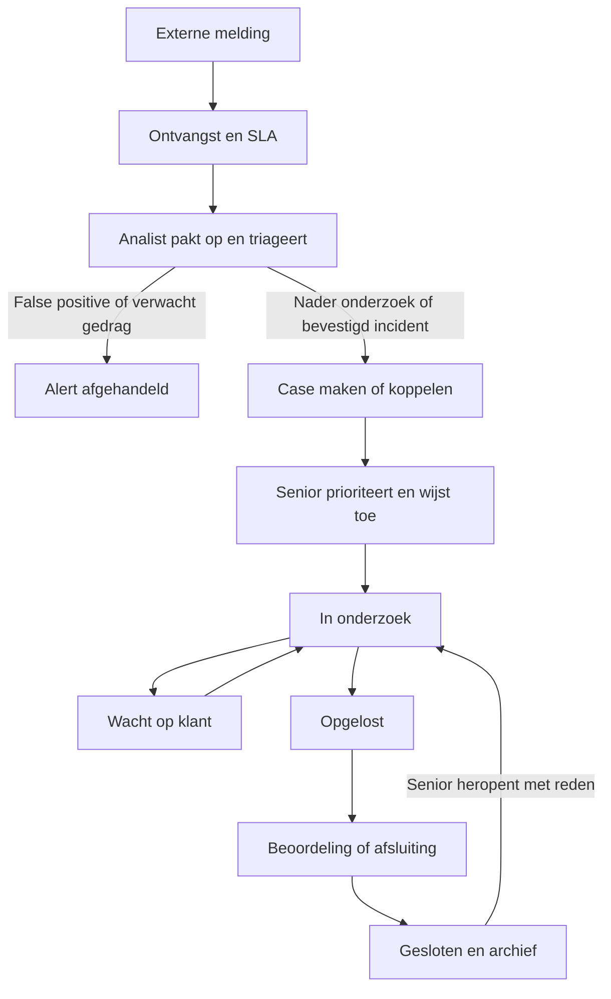
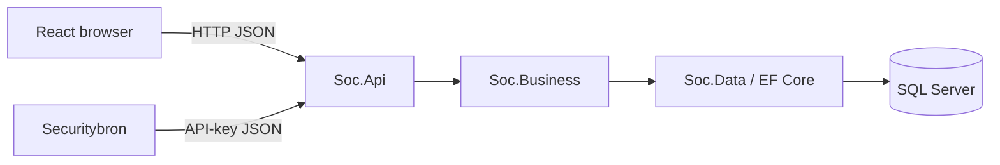
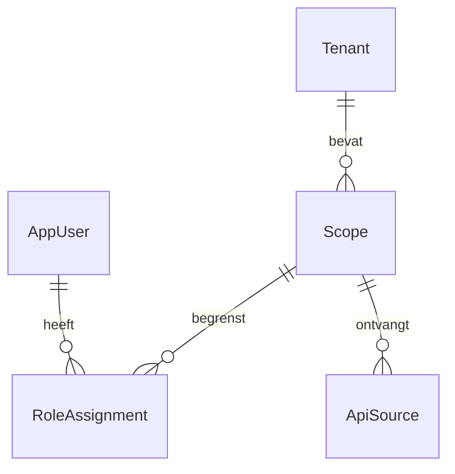
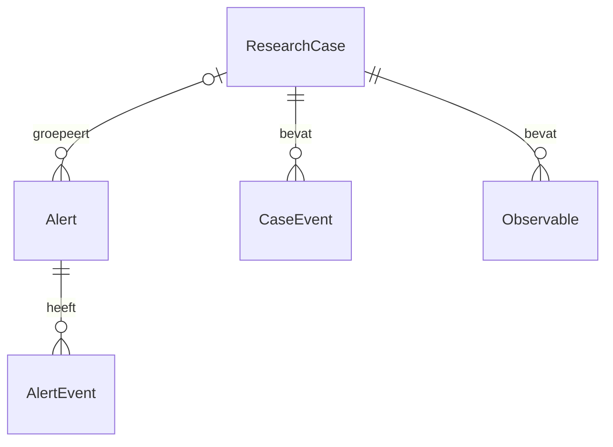

# SOC3 Management — Demohandleiding

**SE3 · Multilayer Webapplications · Projectgroep 3**

Een incidentcasemanagementplatform voor een MSSP Security Operations Centre (SOC). Deze repository bevat de demonstratie-MVP: React, ASP.NET Core, Entity Framework Core en SQL Server.

## Snel starten

Open Docker Desktop. Vanuit de hoofdmap van het project:

```bash
git pull --ff-only origin main && docker compose up --build --wait --wait-timeout 360
```

**Website:** [http://localhost:8081](http://localhost:8081)  
**Demowachtwoord voor alle onderstaande accounts:** `Demo2026!`

| Groepslid | E-mailadres | Rol |
| --- | --- | --- |
| Teun Hanssen | teun@soc.demo | Beheerder |
| Dominique Roosen | dominique@soc.demo | Senior analist |
| Sergio Mendez | sergio@soc.demo | Analist |
| Hamza Ben Ali | hamza@soc.demo | Analist |
| Ruben Abrahamse | ruben@soc.demo | Accountmanager |
| Thijs Dronkers | thijs@soc.demo | Klant |

Dit zijn fictieve lokale demoaccounts en gekozen demonstratierollen, geen officiële taakverdeling. Het wachtwoord is het initiële demowachtwoord: een bestaande database behoudt gewijzigde wachtwoorden, verwijderde accounts en 2FA-instellingen. Gebruik deze gegevens nooit voor productie.

## Inhoud

- [1. Installatie](#1-installatie)
- [2. Demonstratie voor de groep](#2-demonstratie-voor-de-groep)
- [3. Functionele werking en rollen](#3-functionele-werking-en-rollen)
- [4. API-aanlevering](#4-api-aanlevering)
- [5. Technische architectuur](#5-technische-architectuur)
- [6. Database](#6-database)
- [7. API-contracten](#7-api-contracten)
- [8. Beveiliging](#8-beveiliging)
- [9. Ontwikkelen en testen](#9-ontwikkelen-en-testen)
- [10. Opdrachtgever en eisenmatrix](#10-opdrachtgever-en-eisenmatrix)
- [11. Vragen van de docent](#11-vragen-van-de-docent)
- [12. Status en herkomst](#12-status-en-herkomst)


## 1. Installatie — Windows, macOS en Linux

### 1.1 Wat heb je nodig?

- Toegang tot de private GitHub-repository SOC3-Project.
- [Git](https://git-scm.com/downloads) en [Docker Desktop](https://www.docker.com/products/docker-desktop/) op Windows/macOS. Op Linux kan ook Docker Engine met de Compose v2-plugin.
- Internet om de images en dependencies op te halen.
- Bij voorkeur 16 GB RAM, met circa 6–8 GB beschikbaar voor Docker, en voldoende vrije schijfruimte (richtwaarde 15 GB).
- Voor de gewone demo hoef je geen Node.js, .NET SDK, SQL Server of DataGrip apart te installeren.

| Laptop | Route |
| --- | --- |
| Windows Intel/AMD | Docker Desktop met WSL 2 en Linux-containers |
| Mac Intel | Docker Desktop voor Intel |
| Mac Apple Silicon (M1 en nieuwer) | Docker Desktop voor Apple Silicon, amd64-emulatie voor SQL Server |
| Windows ARM/Snapdragon of Linux ARM | Probeer amd64-emulatie; gebruik anders de externe SQL-route hieronder |
| Linux Intel/AMD | Docker Engine + Compose v2 of Docker Desktop |

Windows: schakel hardwarevirtualisatie in indien nodig, gebruik WSL 2 en start Docker Desktop. Controleer met `wsl --status` in PowerShell. Gebruik Linux-containers, geen Windows-containers. Op Mac: installeer de juiste Docker Desktop-versie; op Apple Silicon kan Rosetta-emulatie helpen als de optie beschikbaar is. Microsoft ondersteunt SQL Server Linux-containers officieel uitsluitend op x86-64; Rosetta/QEMU/Prism-emulatie is niet ondersteund. Zie [Microsoft-documentatie](https://learn.microsoft.com/en-us/sql/linux/containers/deploy?view=sql-server-ver16). Er is daarom geen garantie dat SQL Server lokaal op iedere ARM-laptop draait.

### 1.2 Eerste keer starten

Open Docker Desktop en wacht tot de engine actief is. Open PowerShell, Terminal of een Linux-shell:

```bash
git --version
docker version
docker compose version
git clone https://github.com/TeunHSytrius/SOC3-Project.git
cd SOC3-Project
docker compose up --build --wait --wait-timeout 360
```

Gebruik bij een bestaande kopie vanuit de hoofdmap:

```bash
git pull --ff-only origin main
docker compose up --build --wait --wait-timeout 360
```

Het commando bouwt de frontend en backend, wacht op de SQL Server-healthcheck en controleert daarna de API. Bij een succesvolle start staan app en sqlserver op healthy. Open [http://localhost:8081](http://localhost:8081). Log in met een groepsaccount bovenaan deze README en het initiële wachtwoord `Demo2026!`.

```bash
docker compose ps
```

Healthcheck in de browser: [http://localhost:8081/api/v1/health](http://localhost:8081/api/v1/health). Verwacht `{"status":"ok"}`. In Windows PowerShell kan ook `curl.exe http://localhost:8081/api/v1/health`; in macOS/Linux `curl -fsS http://localhost:8081/api/v1/health`.

### 1.3 Problemen oplossen

Voer eerst vanuit de hoofdmap uit (op alle platforms):

```bash
docker compose ps -a
docker compose logs --tail=100 app sqlserver
```

Als de build faalt: `docker compose build --progress=plain`. Deel de foutmelding vanaf de eerste echte error, plus je besturingssysteem en processor. Deel geen wachtwoorden of API-sleutels.

| Probleem | Wat te doen |
| --- | --- |
| git clone geeft 403/404 | Controleer of je toegang tot de private repo hebt en of Git is ingelogd. |
| Docker daemon niet bereikbaar | Start Docker Desktop en controleer docker version. |
| compose onbekend | Installeer/actualiseer Compose v2; gebruik docker compose met spatie. |
| Windows-containerimage fout | Schakel naar Linux-containers. |
| Exited 137 / out of memory | Geef Docker meer geheugen of sluit zware programma's. |
| SQL Server unhealthy | Controleer sqlserver-logs, processor, geheugen en wachtwoord van het bestaande volume. |
| Exec format error / emulatiecrash | Controleer ARM-emulatie; gebruik de externe SQL-route indien nodig. |
| Port already allocated | Wijzig alleen de conflicterende hostpoort in .env (zie 1.4). |
| npm- of C#-buildfout | Deel de buildlog; dit is mogelijk een code-/dependencyprobleem en niet je laptop. |
| Init mislukt / onvolledige demo | Deel de app-logs. Wis geen database om de fout te verbergen. |
| Website niet bereikbaar | Wacht op healthy, controleer de gekozen poort en gebruik localhost. |

Normaal stoppen: `docker compose down`. Het databasevolume en de 2FA-sleutels blijven behouden. Gebruik **geen** `docker compose down -v`: daarmee verwijder je de opgeslagen data.

### 1.4 Andere poorten gebruiken (alleen bij conflict)

Maak in de hoofdmap een bestand .env op basis van .env.example. Bijvoorbeeld:

```dotenv
SOC_APP_PORT=8082
SOC_SQL_PORT=14334
```

Start opnieuw met `docker compose up --build --wait --wait-timeout 360`. Open dan http://localhost:8082 en gebruik DataGrip-poort 14334. Pas ook de simulator, Vite API-target en eventuele handmatige API-verzoeken aan als je een andere app-poort gebruikt. De interne containerpoorten blijven 8080 en 1433. Wijzig SOC_SQL_PASSWORD niet bij een bestaand SQL-volume zonder het SQL-wachtwoord zelf te wijzigen.

### 1.5 Alternatief wanneer SQL Server niet lokaal draait

Gebruik bij voorkeur een groepslaptop met Intel/AMD waarop Docker werkt, of een beschikbare x86-64-VM. Er zijn twee mogelijkheden:

**A. Alleen de demo bekijken:** draai de volledige applicatie op die machine en gebruik de browser daar, een schermdeling of een beveiligde SSH-tunnel (alleen als een SSH-server en toegang al zijn geregeld):

```bash
ssh -N -L 8081:127.0.0.1:8081 gebruiker@adres-van-demo-host
```

Open op je eigen laptop http://localhost:8081. Deel de demo niet via een publiek geopende HTTP-poort.

**B. Zelf de app lokaal draaien met externe SQL Server:** de repository bevat compose.external.yaml. Regel eerst met de groep een bereikbare SQL Server 2022 op x86-64, een eigen lege demodatabase en een account met rechten om daarin tabellen/schema's aan te maken. Gebruik nooit de productiedatabase of een database die een andere onafhankelijke demo gebruikt. Configureer in je lokale .env de echte connectiestring, bijvoorbeeld (vervang alle voorbeeldwaarden):

```dotenv
SOC_EXTERNAL_SQL_CONNECTION=Server=sql-demo.example,1433;Database=Soc3DevHamza;User Id=socdev;Password=VUL_EIGEN_WACHTWOORD_IN;Encrypt=True;TrustServerCertificate=False
```

Gebruik een geldig vertrouwd SQL-certificaat. Bij een beveiligde tunnel naar een lokale poort kan de servernaam host.docker.internal zijn; stem de TLS-configuratie af met de beheerder. Start vervolgens:

```bash
docker compose stop app
docker compose -f compose.external.yaml up --build --wait --wait-timeout 360
```

Hierbij wordt alleen de app lokaal gebouwd (native architectuur); er start geen lokale SQL Server-container. De backend initialiseert de eigen demodatabase. Stop met `docker compose -f compose.external.yaml down`. Er is geen externe host voor jullie ingericht: deze route vereist een beschikbare SQL Server of VM. Geen SQLite-fallback; de SQL Server-architectuur blijft behouden.

### 1.6 DataGrip (optioneel)

| Instelling | Standaardwaarde |
| --- | --- |
| Type | Microsoft SQL Server |
| Host | 127.0.0.1 |
| Port | 14333 (of SOC_SQL_PORT) |
| User | sa |
| Password | SocDemo!2026Local (of bestaande SOC_SQL_PASSWORD) |
| Database | Soc3Demo |
| Encrypt | true |
| Trust server certificate | true, uitsluitend voor lokale demo |

De backend maakt de database, platform-schema en klantschema's automatisch aan. Download de JDBC-driver en klik Test Connection. Selecteer platform en tenant_... in het schema-overzicht.

```sql
SELECT Id, Name, SchemaName, IsActive, ResponseMinutes
FROM platform.Tenants;
```

### 1.7 Test zonder Node.js op je laptop

```bash
docker compose --profile test run --rm smoke
```

Deze test gebruikt de Node-container en maakt fictieve testrecords aan. Gebruik de standaard generieke testaccounts; activeer daarop geen 2FA. GitHub Actions bevat daarnaast een automatische Docker-build en smoketest op een schone x86-64-runner. Controleer [Actions](https://github.com/TeunHSytrius/SOC3-Project/actions) voor het werkelijke resultaat; een workflowbestand betekent niet dat de build is geslaagd.

## 2. Demonstratie voor de groep

### Doel van de applicatie

De opdrachtgever gebruikt een verouderd IT-ticketsysteem, spreadsheets en mondelinge overdrachten voor securityonderzoek. Ons platform brengt de alertwachtrij, triage, onderzoek, overdracht, observables, SLA en klantportaal samen in één dossier. Een MSSP bedient meerdere organisaties; gegevens worden per tenant en scope afgeschermd.

Wij bouwen **geen SIEM, antivirus of eigen detectiemotor**. Externe tooling levert meldingen aan; ons platform ondersteunt de incident response.

### Vooraf controleren

- Start Docker en controleer `docker compose ps` en de healthcheck.
- Controleer de zes accounts, de juiste klanttoegang en de schermen. Gebruik een lokaal demoaccount, geen echte persoonsgegevens of productiegegevens.
- Oefen de volledige onderstaande route vóór de presentatie. Bewaar de bestaande database; verwijder geen volumes.
- Wissel rollen via Uitloggen en Inloggen in hetzelfde tabblad. Cookies worden tussen tabbladen gedeeld; een nieuw tabblad kan de vorige sessie beëindigen.
- Noteer tijdens de demo het alertnummer en casenummer, zodat elk volgend groepslid hetzelfde dossier kan openen.
- Gebruik één nieuwe alert via de ingest-API, zodat bestaande eigenaren en statussen uit eerdere demonstraties geen probleem vormen.

### Demonstratievolgorde (voorstel: 12–15 minuten)

De volgorde hieronder is een voorstel om iedereen een duidelijk onderdeel te geven. De werkelijke groepsbijdragen moeten afzonderlijk en eerlijk worden toegelicht.

| Stap | Wie / rol | Wat laten we zien? |
| --- | --- | --- |
| 1 | Teun – beheerder | Probleemstelling, dashboard, klanten en API-sleutel |
| 2 | Hamza – analist | Alert ontvangen, securitycontext, FIFO en triage |
| 3 | Dominique – senior analist | Case prioriteren en toewijzen |
| 4 | Sergio – analist | Dossier, notities, observables en acties |
| 5 | Thijs – klant | Vrijgegeven dossier en klantreactie |
| 6 | Ruben – accountmanager | Klantgebonden leesrechten |
| 7 | Sergio en Teun | Afsluiten, archief, audit en technische onderbouwing |

### Stap 1 — Teun: platformbeheer en alertontvangst

Log in met `teun@soc.demo`.

1. Toon het SOC-dashboard: openstaande alerts, lopende cases, SLA-risico, overschrijdingen en het diagram met ontvangen alerts per prioriteit.
2. Selecteer Northstar Finance en laat zien dat de gegevens wijzigen met de klantcontext.
3. Open Klanten en Gebruikers & rollen. Laat zien hoe klanten, accounts en rechten worden beheerd. Bewerk of verwijder geen groepsaccount tijdens de demo.
4. Open API-sleutels en maak een tijdelijke sleutel voor Northstar Finance met de naam Demo securitytool. Kopieer de sleutel; deze is maar één keer volledig zichtbaar.
5. Stuur de voorbeeldmelding hieronder vanuit de terminal. Noteer het teruggegeven alertnummer.

```bash
# macOS zsh
read -rs 'SOC_KEY?API-sleutel: '
curl -i -X POST http://localhost:8081/api/v1/ingest/alerts \
  -H "X-API-Key: $SOC_KEY" \
  -H 'Content-Type: application/json' \
  -d "{\"externalEventId\":\"demo-$(date +%s)\",\"title\":\"Verdachte VPN-aanmelding demo\",\"occurredAt\":\"$(date -u +%Y-%m-%dT%H:%M:%SZ)\",\"severity\":\"High\",\"payload\":{\"simulated\":true,\"category\":\"Authenticatie\",\"description\":\"Aanmelding vanaf een onbekende locatie na meerdere mislukte pogingen.\",\"sourceIp\":\"192.0.2.45\",\"destinationIp\":\"198.51.100.10\",\"hostname\":\"DEMO-VPN01\",\"username\":\"demo.user\",\"detectionRule\":\"AUTH-001\"}}"
unset SOC_KEY
```

Verwacht HTTP 201. De sleutel bepaalt de klant en scope aan de serverzijde; een bron mag deze niet zelf kiezen.

**Uitleg:** De beheerder ziet alle klantdossiers, maar behandelt geen alerts. Het diagram telt echte opgeslagen demorecords; de beveiligingsgebeurtenissen zelf zijn fictief.

### Stap 2 — Hamza: alertanalyse en triage

Log in met `hamza@soc.demo`. Ga naar Alerts → Openstaand. Selecteer Northstar Finance en zoek op Verdachte VPN-aanmelding demo of het alertnummer.

1. Open de nieuwe alert en bekijk de bron, prioriteit, deadline, securityinformatie en originele JSON.
2. Klik Oppakken. Het eerste behandelmoment en de eigenaar worden vastgelegd.
3. Kies Nader onderzoek en geef als toelichting: `Aanmelding wijkt af van normaal gedrag; VPN- en authenticatielogs moeten worden gecontroleerd.`
4. Klik Beoordeling opslaan en vervolgens Case maken / koppelen. Gebruik de titel Onderzoek verdachte VPN-aanmelding demo.
5. Noteer het casenummer. De alert staat nu onder Gekoppeld aan case.

**Uitleg:** Niet iedere alert is een incident. Triage onderscheidt ruis, verwacht gedrag, nader onderzoek en bevestigde incidenten. FIFO betekent oudste openstaande meldingen eerst; de SLA van standaard 60 minuten meet de tijd tot oppakken.

### Stap 3 — Dominique: prioriteren en toewijzen

Log in met `dominique@soc.demo` en open het zojuist aangemaakte ticket.

1. Klik Prioriteren en toewijzen.
2. Kies Sergio Mendez als eigenaar, prioriteit Hoog.
3. Toelichting: `Afwijkende aanmelding nader onderzoeken; mogelijke ongeautoriseerde toegang.`
4. Volgende actie: `VPN-logs en authenticatielogs controleren.`
5. Sla op en toon de status In onderzoek en overdracht in de tijdlijn.

**Uitleg:** De senior bewaakt prioriteit en eigenaarschap. Bij overdracht wordt vastgelegd van wie, naar wie, wanneer, waarom en wat de volgende actie is.

### Stap 4 — Sergio: onderzoeksdossier

Log in met `sergio@soc.demo`, zoek het casenummer en open de toegewezen case.

| Knop | Voorbeeldinvoer |
| --- | --- |
| + Notitie | VPN-log nagekeken; onbekende bronlocatie vastgesteld. |
| + Observable | Type IP, waarde 192.0.2.45, beoordeling Verdacht |
| + Actie | Aanvullende authenticatielogs bij klant opgevraagd. Vink Vrijgeven aan klant aan. |
| + Bewijsreferentie | DEMO-VPN01 / authenticatielog / demo-event-ID |

Laat de notitie intern. Observables en bewijsreferenties blijven intern. Geef vervolgens de case vrij via Vrijgeven aan klant. Verander de status eventueel naar Wacht op klant.

**Uitleg:** Alle informatie wordt per ticket opgeslagen via CaseId en ScopeId. Een observable is een waarneembaar gegeven, niet automatisch een bewezen dreiging. Bewijsreferenties zijn tekst; er is nog geen bestandsupload.

### Stap 5 — Thijs: klantportaal

Log in met `thijs@soc.demo`. Open Cases en zoek hetzelfde ticket.

- Toon dat de vrijgegeven actie zichtbaar is, maar de interne notitie, observable en ruwe alertgegevens niet.
- Voeg een reactie toe: `De gevraagde logs zijn beschikbaar voor het SOC.`
- Controleer dat andere klantorganisaties niet selecteerbaar zijn.

**Uitleg:** De backend controleert tenant, scope en klantzichtbaarheid. Het verbergen van knoppen in React is niet de beveiligingsgrens.

### Stap 6 — Ruben: accountmanager

Log in met `ruben@soc.demo`. Toon vrijgegeven cases van de gekoppelde klanten (standaard Northstar Finance en Delta Logistics). Zoek hetzelfde ticket. Laat zien dat de accountmanager kan lezen, maar geen interne onderzoeksacties kan uitvoeren.

**Uitleg:** Eén gebruiker kan toegang hebben tot meerdere organisaties, zonder automatisch toegang te krijgen tot alle klanten.

### Stap 7 — Sergio en Teun: afsluiting en controle

Sergio opent het ticket opnieuw. Als de status Wacht op klant is, zet deze eerst terug naar In onderzoek. Kies daarna Opgelost, en vervolgens Gesloten. Vul de verplichte samenvatting en conclusie in op basis van de fictieve oefening, bijvoorbeeld: `Aanmelding onderzocht en met de klant afgestemd.` en `Demo afgerond; geen werkelijk incident vastgesteld.`

Toon het ticket in Archief en de gekoppelde alert onder Afgehandeld. De oude notities blijven zichtbaar.

Teun logt opnieuw in en toont hetzelfde afgesloten ticket, inclusief interne notities en historie. Open Auditlog en zoek het alert- of casenummer. Toon Foutenlog indien relevant. Trek de tijdelijke API-sleutel in.

### Authenticator en QR-code (optionele extra demonstratie)

Open Account bij een afzonderlijk tijdelijk demoaccount. Maak de QR-code, scan deze met Microsoft Authenticator of Google Authenticator, voer de zescijferige code in en bewaar de herstelcodes veilig. Log opnieuw in om de tweede factor te tonen.

Gebruik hiervoor niet de generieke smoketestaccounts. Activeer 2FA niet vlak vóór de presentatie op een account dat een ander groepslid nodig heeft. Toon geen geheime QR-code of herstelcodes aan het publiek.


## 3. Functionele werking en rollen

### Rollenmatrix

| Functionaliteit | Beheerder | Analist | Senior | Klant | Accountmanager |
| --- | --- | --- | --- | --- | --- |
| SOC-dashboard en alerts | Alle, lezen | Bevoegde | Bevoegde | Nee | Nee |
| Ticketdossiers en archief | Alle, lezen | Bevoegde | Bevoegde | Vrijgegeven | Vrijgegeven |
| Alert oppakken en triage | Nee | Ja | Ja | Nee | Nee |
| Case prioriteren en initieel toewijzen | Nee | Nee | Ja | Nee | Nee |
| Onderzoeksinformatie wijzigen | Nee | Eigen case | Bevoegde case | Alleen reactie | Nee |
| Klanten, gebruikers en bronintegraties beheren | Ja | Nee | Nee | Nee | Nee |
| Auditlog en foutenlog | Ja | Nee | Nee | Nee | Nee |
| Eigen 2FA instellen | Ja | Ja | Ja | Ja | Ja |

De beheerder heeft op uitdrukkelijk verzoek platformbrede leesrechten, ook voor inactieve klanten. Dit wijkt af van de oorspronkelijke TO-rollenmatrix en vereist goedkeuring van de opdrachtgever voor echte klantgegevens. Operationele schrijfrechten blijven afzonderlijk. Analisten lezen binnen toegewezen actieve klanten en scopes; klanten zien uitsluitend vrijgegeven dossiers.

Algemene testaccounts (initieel hetzelfde wachtwoord `Demo2026!`): `beheerder@soc.demo`, `analist@soc.demo`, `senior@soc.demo`, `klant@soc.demo`, `accountmanager@soc.demo`. Gebruik deze niet voor accountverwijdering of 2FA tijdens de demo.

### Workflow



De backend bewaakt de toegestane statusovergangen. De afzonderlijke procesrollen uit de opdracht zijn nog niet volledig gerealiseerd.

### Schermen en gegevens

- **Dashboard:** hetzelfde voor analist en beheerder, met extra beheerknoppen voor beheerder. Alertvolume per prioriteit over 24 uur of zeven kalenderdagen; verticale FIFO-wachtrij en recente openstaande meldingen. Polling elke 15 seconden op actieve overzichten.
- **Alerts:** Openstaand, Gekoppeld aan case, Afgehandeld, Alle alerts. Zoek en filter op klant, status, prioriteit, eigenaar, datum, SLA, categorie en securitytool.
- **Tickets:** Lopend, Opgelost – nog afsluiten, Archief, Alle tickets. Zoek ook op notities en observables. Afgesloten tickets blijven bewaard.
- **Onderzoeksdossier:** meerdere alerts per case; eigen notities, observables, acties, bewijsreferenties en tijdlijn. Klantzichtbaarheid wordt server-side gefilterd.
- **SLA:** standaard 60 minuten tot eerste behandeling, instelbaar per klant voor nieuwe alerts. Waarschuwing bij maximaal 15 minuten resterend. Geen afzonderlijke case-afhandel-SLA.
- **Gebruikers:** aanmaken, wijzigen, deactiveren, heractiveren en verwijderen. Verwijderen is soft delete: toegang ingetrokken, historie behouden, account uit lijst. Eigen account kan niet worden verwijderd; e-mailadres blijft gereserveerd.
- **Klanten:** aanmaken, hernoemen, deactiveren, heractiveren; eigen schema en standaard scope.
- **Foutenlog:** maximaal 500 technische API-fouten sinds backendstart, inclusief HTTP-status en foutreferentie. Geen permanente opslag of vertrouwelijke requestinhoud. Auditlog en onderzoekshistorie staan wel in SQL Server.

De database start met drie fictieve klanten, acht oorspronkelijke demo-alerts en één lopende case. De demo-alerts krijgen fictieve securitycontext. Bestaande status, eigenaar en historie blijven behouden. Er worden niet automatisch afgesloten cases verzonnen; maak er één via de demonstratieroute of gebruik bestaande cases.


## 4. API-aanlevering

Er is een echte ingest-API, maar geen live koppeling met Sentinel, Defender of Splunk. Een optionele simulator stuurt fictieve beveiligingsmeldingen via diezelfde API. De namen van deze bronnen in de demodata zijn fictieve labels.

Maak als beheerder onder API-sleutels een sleutel voor Northstar Finance. Stuur daarna een fictieve melding via de terminal:

```bash
read -rs 'SOC_KEY?API-sleutel: ' # zsh op macOS
curl -X POST http://localhost:8081/api/v1/ingest/alerts \
  -H "X-API-Key: $SOC_KEY" \
  -H 'Content-Type: application/json' \
  -d '{"externalEventId":"demo-001","title":"Testmelding","occurredAt":"2026-11-25T12:00:00Z","severity":"High","payload":{"description":"Fictieve melding voor de demo"}}'
unset SOC_KEY
```

Verwacht HTTP 201 bij een nieuw event-ID. Identieke herhaling geeft 200 met hetzelfde alert-ID; gewijzigde bytes onder hetzelfde event-ID geven 409. Gebruik een nieuw event-ID voor elke nieuwe melding. Klant-, scope- en andere niet-contractvelden worden geweigerd. Het oorspronkelijke JSON-bericht en de SHA-256-hash worden opgeslagen. De maximale berichtgrootte is 1 MiB. Vernieuw daarna het dashboard als analist. De API-key bepaalt server-side klant en scope; waarden uit de requestbody mogen dit niet overschrijven. Ongeldige of ingetrokken sleutels geven HTTP 401.

### Alertsimulator

Maak als beheerder een API-sleutel met bronnaam Demo securitytool voor een actieve klant. Kopieer de sleutel eenmalig. Start vervolgens vanuit de hoofdmap:

```bash
read -rs 'SOC_SIM_KEY?API-sleutel: '
export SOC_SIM_KEY
node scripts/simulate-alerts.mjs
```

Of voer na dezelfde export uit:

```bash
docker compose --profile simulator run --rm -e SOC_SIM_KEY simulator
```

De simulator stuurt iedere 30 seconden een fictieve alert naar de echte ingest-API. Stop met Ctrl+C en voer `unset SOC_SIM_KEY` uit. De simulator maakt geen netwerkverbindingen met de IP-adressen uit de voorbeelden en voert geen echte detectie uit. De API-sleutel bepaalt klant en scope. Start hem alleen voor de demo; hij is standaard uitgeschakeld. De voorbeeld-IP's zijn documentatieadressen.

## 5. Technische architectuur

| Laag | Technologie |
| --- | --- |
| Frontend | React 19, TypeScript, Vite 7, CSS |
| API | ASP.NET Core 10, C#, REST |
| Business | C#-services, DTO's en bedrijfsregels |
| Data | Entity Framework Core 10, SQL Server 2022 |
| Authenticatie | ASP.NET Core Identity, cookies, TOTP |
| API-documentatie | OpenAPI |
| Uitvoering | Docker, Docker Compose |
| Integratietests | Node.js, fetch en assert |



De controllers handelen HTTP-verzoeken af. SocService voert bedrijfsregels en domeinautorisatie uit. Soc.Data beheert entiteiten, databasecontexten en schema's. De frontend gebruikt same-origin JSON-verzoeken en haalt voor schrijfacties een CSRF-token op.

```text
SOC3.slnx
backend/
  Soc.Api/
    Controllers/      REST-routes
    Security/         Beschermde Identity-opslag
    Program.cs        DI, middleware en initialisatie
  Soc.Business/
    DTOs/             Invoer- en antwoordcontracten
    Services/         Bedrijfsregels en autorisatie
  Soc.Data/
    Context/          DbContext en tenantfactory
    Entities/         Datamodel en enums
frontend/
  src/
    components/       AppShell, AppMenu, PageHeader en UI
    features/         Login en aanvullende CSS
    services/         API-client
    types/            Domeintypen en SLA-berekening
    App.tsx           Schermen, navigatie en applicatiestate
compose.yaml          Containerconfiguratie
Dockerfile            Multi-stage build
scripts/              Controle- en branchscripts
tests/smoke.mjs       API-integratietest
README.md             Functionele en technische handleiding
```

De multi-stage Dockerfile bouwt de React-app en ASP.NET Core-applicatie; de statische frontend wordt gepubliceerd in wwwroot. Styling gebruikt de index.css van main in de groepsrepository, met uitsluitend een flexibele rootbreedte in plaats van 1126px, en de aangepaste horizontale navigatiebranch. De globale accentvariabelen zijn behouden.

## 6. Database

Eén SQL Server-database, Soc3Demo, bevat een platform-schema en per klant een afzonderlijk schema. De klantschemanaam wordt server-side gegenereerd als tenant_ gevolgd door de klant-GUID zonder streepjes.

### Platform

| Entiteit | Doel |
| --- | --- |
| Tenant | Klantnaam, status en schemanaam |
| Scope | Werkruimte binnen een klant |
| AppUser / Identity-tabellen | Accounts, wachtwoordhashes, tokens |
| RoleAssignment | Gebruiker-, tenant- en scopetoewijzing |
| ApiSource | Bron, sleutelhash, prefix, tenant en scope |
| PlatformAudit | Centrale auditregels |



### Per klantschema

| Entiteit | Doel |
| --- | --- |
| Alert | Beveiligingsmelding, prioriteit, status, deadline, eigenaar |
| AlertEvent | Status- en actiegeschiedenis |
| ResearchCase | Onderzoek, eigenaar, conclusie, klantzichtbaarheid |
| CaseEvent | Notities, acties, bewijsreferenties, klantreacties |
| Observable | Interne onderzoeksindicator |
| TenantAudit | Auditregels binnen klantcontext |



De diagrammen tonen de expliciet gemodelleerde kernrelaties, niet alle Identity-tabellen of logische GUID-verwijzingen. TenantAudit is zelfstandig. ScopeId begrenst operationele gegevens; eigenaar-ID's verwijzen logisch naar platformgebruikers.

SocDbContext beheert platformgegevens. TenantDbContext beheert operationele tabellen in het geselecteerde schema. TenantDbFactory selecteert het schema; SchemaModelCacheKeyFactory neemt de schemanaam op in de EF-modelcache. De demo gebruikt EnsureCreated en CreateTablesAsync voor provisioning, niet een formeel migratieproces. Alle schema's delen een databaseverbinding; isolatie is dus afhankelijk van de correcte server-side selectie en autorisatie.

## 7. API-contracten

Basis-URL: `http://localhost:8081/api/v1`. OpenAPI: [openapi/v1.json](http://localhost:8081/openapi/v1.json).

| Methode | Endpoint | Functie |
| --- | --- | --- |
| GET | /health | Healthcheck |
| GET | /auth/csrf | CSRF-token |
| POST | /auth/login | Inloggen |
| POST | /auth/2fa | Tweede factor afronden |
| GET | /auth/me | Eigen profiel |
| POST | /auth/logout | Uitloggen |
| POST | /auth/2fa/setup | Authenticator instellen |
| POST | /auth/2fa/enable | 2FA activeren |
| GET | /me/access | Klant- en scopetoegang |
| POST | /ingest/alerts | API-key ingest |
| GET, POST | /alerts | Lijst of handmatig aanmaken |
| GET | /alerts/{id} | Details |
| POST | /alerts/{id}/claim | Oppakken |
| POST | /alerts/{id}/triage | Triage |
| POST | /alerts/{id}/promote | Case maken/koppelen |
| POST | /alerts/{id}/reopen | Heropenen |
| GET | /cases | Onderzoeken |
| GET, PATCH | /cases/{id} | Details/status/eigenaar/zichtbaarheid |
| POST | /cases/{id}/events | Tijdlijnitem |
| POST | /cases/{id}/observables | Observable |
| POST | /cases/{id}/alerts | Alert koppelen |
| GET | /portal/cases | Vrijgegeven cases |
| GET | /portal/cases/{id} | Vrijgegeven details |
| GET, POST | /organizations | Klantenlijst/aanmaken |
| GET, PATCH | /organizations/{id} | Details/naam wijzigen |
| POST | /organizations/{id}/activate | Activeren |
| POST | /organizations/{id}/deactivate | Deactiveren |
| GET, POST | /users | Accounts bekijken/aanmaken |
| PATCH | /users/{id} | Account bewerken |
| POST | /users/{id}/access | Rol en toegang |
| POST | /users/{id}/remove | Soft delete van account |
| GET, POST | /keys | Sleutels bekijken/aanmaken |
| POST | /keys/{id}/revoke | Sleutel intrekken |
| GET | /audit | Auditlog |
| GET | /errors | Tijdelijk technisch foutenlog |
| GET | /ticket-register | Administratieve ticketmetadata |
| GET | /analysts | Analisten voor overdracht |

PATCH /users/{id} verwacht name, email, role, organizationIds en isActive. password is optioneel. PATCH /organizations/{id} verwacht name. De klant-GUID blijft behouden.

X-Workspace-Id en X-Scope-Id beperken de context voor operationele endpoints. Deze headers verlenen geen rechten. De server controleert de toewijzingen. Schrijfacties gebruiken CSRF, behalve de API-key-ingest.

HTTP-statuscodes: 200 geslaagd, 201 aangemaakt, 400 ongeldige invoer/CSRF, 401 niet geauthenticeerd, 403 geen toegang, 404 niet gevonden, 409 conflict, 429 rate limit, 500 serverfout.

## 8. Beveiliging

- Identity verzorgt wachtwoordhashing, aanmeldcontrole en lockout na vijf mislukte wachtwoordpogingen.
- Cookies zijn HttpOnly en SameSite=Lax; buiten demo is Secure vereist.
- De website vraagt bij een nieuwe navigatie opnieuw om inloggen en beëindigt de vorige cookie-sessie. Bij een gewone refresh in een eerder ingelogd tabblad wordt de sessie hersteld zolang de server deze accepteert. De browser bewaart alleen de gebruikers-ID in sessionStorage; de authenticatiecookie blijft HttpOnly. Cookies worden gedeeld tussen tabbladen: een nieuw tabblad kan dus ook de sessie van het oude tabblad beëindigen. Een accountwisseling in een ander tabblad leidt tot HTTP 401 bij verzoeken vanuit het oude tabblad met een afwijkende X-SOC-User-header. Deze header is een aanvullende controle, geen authenticatiemiddel.
- POST/PATCH onder /api/v1 vereisen een CSRF-token, behalve ingest. Een aanwezige Origin-header wordt gecontroleerd.
- TOTP met authenticator, QR-code en herstelcodes; het authenticatorgeheim wordt via Data Protection beschermd.
- Analisten, senior analisten en beheerders moeten 2FA instellen, behalve lokale @soc.demo-accounts in demomodus.
- API-sleutels zijn willekeurig gegenereerd, worden als SHA-256-hash opgeslagen en kunnen worden ingetrokken.
- Rate limiting voor login en ingest.
- Server-side rol-, klant-, scope- en zichtbaarheidstoetsing.
- Accountbewerking is transactioneel, alleen voor beheerders en past de security stamp aan. Reguliere stampvalidatie beoordeelt bestaande sessies opnieuw; inactieve accounts worden bij API-aanroepen geweigerd.
- Auditregels registreren geselecteerde lees- en schrijfactiviteiten, inclusief accountwijzigingen en wachtwoordreset (zonder wachtwoord).

De demo draait lokaal via HTTP; de verbinding met SQL Server vraagt encryptie aan maar vertrouwt het servercertificaat. TLS 1.2+ voor browserverkeer is niet aangetoond. Data Protection-sleutels worden lokaal persistent maar niet apart versleuteld opgeslagen. Volledige encryptie-at-rest, volledige auditdekking, retentie, OWASP-toetsing en productiebeveiliging moeten nog worden gerealiseerd of bewezen.

## 9. Ontwikkelen en testen

### Lokale frontendontwikkeling (aanbevolen)

Node 22.12+ (24 aanbevolen). Start de app en SQL Server in Docker. Gebruik Vite voor live wijzigingen; de API blijft op 8081.

```bash
docker compose up --build --wait --wait-timeout 360
cd frontend
# Eenmalig zolang package-lock.json ontbreekt:
npm install --package-lock-only
npm ci
npm run dev
```

Open http://localhost:5173. In een tweede terminal, vanuit frontend: `npm run build`. Commit package-lock.json; daarna volstaat npm ci. De frontend heeft nog geen lint-script.

### Backend lokaal ontwikkelen

.NET 10 SDK. Start alleen de databasecontainer en gebruik een afzonderlijke ontwikkel-database Soc3Dev. Gebruik het eigen lokale SQL-wachtwoord indien aangepast.

```bash
docker compose stop app
docker compose up -d sqlserver
dotnet restore SOC3.slnx
dotnet build SOC3.slnx
export ConnectionStrings__Soc='Server=127.0.0.1,14333;Database=Soc3Dev;User Id=sa;Password=SocDemo!2026Local;Encrypt=True;TrustServerCertificate=True'
export Demo__Enabled=true
export ASPNETCORE_ENVIRONMENT=Development
dotnet watch --project backend/Soc.Api/Soc.Api.csproj run --no-launch-profile --urls http://localhost:8080
```

In een tweede terminal vanuit de hoofdmap: `cd frontend && VITE_API_TARGET=http://127.0.0.1:8080 npm run dev`. Open http://localhost:5173. De Vite-proxy gebruikt standaard Docker-poort 8081, met deze override de lokale backend 8080. Geen databasevolumes wissen.

### Smoketest

```bash
bash scripts/check-demo.sh
```

Voor de variant zonder Docker: `SOC_URL=http://localhost:8080 bash scripts/check-demo.sh`.

De test wacht op de healthcheck en controleert authenticatie, rollen, tenantgrenzen, accountbewerking, wachtwoordreset, deactivering/heractivering, klantnaamwijziging, ingest, CSRF, triage, casepromotie, zichtbaarheid, afsluiten, audit en sleutelintrekking. De test schrijft fictieve records. Gebruik oorspronkelijke demoaccounts met de initiële wachtwoorden en zonder geactiveerde 2FA.

De Docker-build, database-upgrade en volledige smoketest voor commit e470595 zijn door een groepslid op een MacBook succesvol uitgevoerd. Sindsdien zijn sessiegedrag, simulator, securitymapping en workflow gewijzigd; de uitgebreide smoketest en browsercontroles moeten opnieuw worden uitgevoerd. Een aanwezige test is geen bewijs dat deze slaagt.

## 10. Opdrachtgever en eisenmatrix

Bron: aangeleverde terugkoppeling van de opdrachtgever na het gesprek, inclusief de 28 aanvullende eisen. Onderstaande matrix beschrijft broncodefunctionaliteit, niet formele acceptatie of bewezen werking. De nummering is lokaal voor dit overzicht.

### Gewenst proces

De opdrachtgever beschrijft vijf stappen:

| Stap | Gewenste procesrol | Huidige MVP / verschil |
| --- | --- | --- |
| 1. Ontvangst en registratie | Ticket Intake Officer | API-ingest en handmatige invoer; geen aparte intake-rol |
| 2. Analyse en classificatie | Security Analyst | Analist claimt en triageert vóór casevorming |
| 3. Prioritering en toewijzing | Security Coordinator | Senior prioriteert en wijst open case toe; geen aparte coördinatorrol |
| 4. Beoordeling en uitvoering | System Owner | Toegewezen analist legt acties vast; geen afzonderlijke System Owner-rol |
| 5. Validatie en afsluiting | Security Analyst | Eerst opgelost, daarna afsluiten met samenvatting en conclusie; onafhankelijke validatie niet afgedwongen |

De FIFO-wachtrij en zelf oppakken blijven voor alertanalyse behouden; nieuwe cases vereisen senior-toewijzing voordat uitvoering kan starten. Casewijzigingen zijn voor de eigenaar of senior (klantreacties uitgezonderd). Leestoegang blijft scope-gebaseerd, behalve de expliciete platformbrede leesrechten van de beheerder. De afzonderlijke opdrachtgeverrollen en exacte taakverdeling moeten nog met FO/TO worden afgestemd. ResearchCase vervult in de MVP de onderzoekstaak.

### Aanvullende eisen

Status: **Aanwezig** = functionaliteit in de broncode; **Deels** = onvolledig; **Open** = ontbreekt of niet bewezen.

| Nr. | Eis | Status | Toelichting |
| --- | --- | --- | --- |
| 01 | Overdracht met toelichting en aandachtspunten | Aanwezig | Verplichte toelichting en volgende actie in tijdlijn |
| 02 | Overdrager, ontvanger en moment vastleggen | Aanwezig | Tijdlijn met vorige en nieuwe eigenaar, ID's, actor en tijd |
| 03 | Eigen toegewezen onderzoeken bekijken | Aanwezig | Filter Mijn onderzoeken op ownerId |
| 04 | Dreigende SLA signaleren | Aanwezig | Dashboard en alertdeadline; geen pushmelding |
| 05 | Overschreden SLA's bij alerts en onderzoeken | Deels | Alert-SLA; geen aparte case-SLA |
| 06 | SLA-instellingen per klant beheren | Aanwezig | Reactietermijn per klant; standaard 60 minuten, alleen nieuwe alerts |
| 07 | Gebruikers koppelen aan klanten en/of rollen | Deels | Meerdere klanten/scopes mogelijk; één rol per account |
| 08 | Verschillende gebruikersrollen | Deels | Vijf huidige rollen; gewenste procesrollen ontbreken deels |
| 09 | Klanten aanmaken, wijzigen, deactiveren | Aanwezig | Inclusief heractiveren en naam wijzigen; nog testen |
| 10 | Gebruikers aanmaken, wijzigen, deactiveren | Aanwezig | Inclusief wachtwoordreset, heractiveren en soft delete; nog testen |
| 11 | Functionaliteit bepalen via rollen | Aanwezig | Server-side rolcontroles en frontendnavigatie |
| 12 | Zoeken op alerts, onderzoeken en observables | Aanwezig | Zoeken op alerts/cases en observables binnen bevoegde cases; client-side |
| 13 | Filteren op klant, status, prioriteit en datum | Aanwezig | Client-side datumfilters en overige filters |
| 14 | Overzicht openstaande alerts en onderzoeken | Aanwezig | Dashboard en lijsten |
| 15 | Actuele status SLA-afspraken | Deels | Eerste behandeling en demo-deadlines; geen klantcontracten |
| 16 | Export onderzoeksinformatie PDF/CSV | Open | Geen exportfunctie |
| 17 | Authenticatie verplicht | Aanwezig | Identity, cookie en aparte ingest-key |
| 18 | Autorisatie op rollen en rechten | Aanwezig | Rol-, tenant- en scopecontroles; gewenste workflow nog afstemmen |
| 19 | TLS 1.2+ tijdens transport | Open | Lokale browserdemo gebruikt HTTP; productie-TLS niet bewezen |
| 20 | Gevoelige gegevens versleuteld opgeslagen | Deels | Wachtwoordhash, keyhash, beschermd TOTP-geheim; geen volledige encryptie-at-rest |
| 21 | Beveiligingsactiviteiten auditloggen | Deels | Geselecteerde acties en reads; niet alle gebruiker-/systeemacties |
| 22 | Bescherming OWASP Top 10 | Deels | CSRF, Identity, rate limiting, EF; geen volledige toetsing |
| 23 | Reguliere acties binnen 2 seconden | Open | Geen representatieve performancetest |
| 24 | Minimaal 50 gelijktijdige gebruikers | Open | Geen loadtest |
| 25 | Schaalbare architectuur | Deels | Meerlagen en klantschema's; schaalbaarheid niet gemeten |
| 26 | Zoeken op alerts en onderzoeken binnen 3 seconden | Open | Geen representatieve zoekperformancetest |
| 27 | Leesbare code en codeconventies | Deels | Projectlagen aanwezig; grote App.tsx/SocService en ontbrekende lint/CI |
| 28 | Geautomatiseerde unit- en integratietests | Deels | Smoketest aanwezig, volledige unit-testset ontbreekt |

### Overige aandachtspunten uit het gesprek

- Relevantie/classificatie van signalen: het systeem ontvangt alerts; het detecteert zelf geen aanvallen. Detectieregels, categorieën en normalisatie moeten nog worden uitgewerkt.
- Audit: opdrachtgever vraagt alle relevante handelingen van gebruiker en systeem. Definieer auditcatalogus, integriteitsbescherming, toegang, bewaartermijnen en toetsbare criteria.
- Bewaarbeleid: opdrachtgever wil hoge dreigingsklassen/escalaties niet verwijderen. De MVP kent geen alert-delete; formeel retentie- en privacybeleid is nog niet bepaald. Stem onbeperkte bewaring en uitzonderingen af met de opdrachtgever en toepasselijke privacyregels.
- Klantisolatie: scheiding per schema en scope is geïmplementeerd; negatieve autorisatie- en isolatietests zijn nodig.
- Overdracht, gestructureerde onderzoeksinformatie, toewijzing en afsluiting moeten de vijf processtappen aantoonbaar ondersteunen. Leg hiervoor acceptatiecriteria en workflowtransities vast.
- NFR-07: maak SLA's instelbaar per organisatie, definieer verschillende termijnsoorten, leg wijzigingen historisch vast en test waarschuwingen en overschrijdingen.

## 11. Vragen van de docent

| Vraag | Antwoord in eigen woorden | Waar in de code? |
| --- | --- | --- |
| Waarom is dit geen gewoon ticketsysteem? | Meerdere securityalerts kunnen één incidentonderzoek vormen. Observables, triage, brondata, SLA, overdracht en tenantisolatie staan centraal. | ResearchCase, Alert, CaseEvent, Observable |
| Hoe loopt een request? | React stuurt HTTP/JSON naar een controller; de service controleert bedrijfsregels en rechten; EF Core voert SQL uit. | api.ts, CasesController.cs, SocService.cs, SocDbContext.cs |
| Hoe komt een alert binnen? | IngestController ontvangt JSON en een bron-API-key. De service valideert en bepaalt de klant/scope. | AlertsController.cs (IngestController), SocService.Ingest |
| Hoe voorkomen jullie duplicaten? | Unieke bron-ID plus extern event-ID, en hash van de oorspronkelijke bytes. Identiek opnieuw verzenden geeft 200; gewijzigde inhoud 409. | Ingest, SocDbContext.cs |
| Hoe is klantenscheiding geregeld? | Eigen SQL-schema per klant, scope binnen de klant en server-side toegangscontrole. De beheerder is een expliciete uitzondering voor lezen. | TenantDbContext, ReadWorkspaces, Workspaces |
| Waarom CaseId én ScopeId? | Een samengestelde foreign key voorkomt dat een onderzoeksrecord aan een case in een andere scope wordt gekoppeld. | SocDbContext.OnModelCreating |
| Hoe werkt een notitie? | POST /cases/{id}/events; service zoekt de bevoegde case, controleert eigenaar en rowversion, voegt CaseEvent toe en slaat op. | CasesController, CaseAction |
| Hoe werkt 2FA? | Een authenticator berekent tijdsgebonden codes met een gedeeld geheim; Identity valideert de code. QR is de configuratie van dat geheim, geen wachtwoord. | AuthController, TwoFactorSetup.tsx |
| Waarom RowVersion? | SQL Server verandert de versie bij een update; een verouderde wijziging wordt geweigerd met 409. | Alert, ResearchCase, CheckVersion |
| Wat is OCSF? | Open Cybersecurity Schema Framework, een gestandaardiseerd securitydatamodel. Onze mapping is gedeeltelijk; de originele payload blijft beschikbaar. | SecurityAlertDetails.cs |
| Hoe meten jullie SLA? | Deadline minus eerste behandelmoment of huidige tijd; overschrijdingen blijven zichtbaar. | GetSlaStatus, domain.ts |
| Waarom Docker? | Herhaalbare runtime met app en SQL Server; volumes bewaren data bij normale herstart. | compose.yaml, Dockerfile |
| Wat is het verschil tussen audit en foutenlog? | Audit legt relevante handelingen vast; foutenlog ondersteunt technische diagnose met een trace-ID. | PlatformAudit, TenantAudit, ApiErrors.cs |

### Probleemoplossing tijdens de demo

| Probleem | Controle |
| --- | --- |
| Website onbereikbaar | `docker compose ps`, healthcheck, daarna `docker compose logs --tail=100 app sqlserver` |
| HTTP 401 | Controleer account, 2FA en sessie; log opnieuw in. |
| HTTP 403 | Controleer rol, klant, scope en eigenaarschap. |
| HTTP 409 | Vernieuw gegevens; controleer statusovergang en recordversie. |
| Geen tickets zichtbaar | Controleer geselecteerde klant, status-tab, filters en klantzichtbaarheid. |
| npm ci faalt | Controleer Node-versie en aanwezigheid van package-lock.json; zie hoofdstuk 9. |
| SQL-verbinding geweigerd | Controleer SQL-container en localhost-poort 14333. |

## 12. Status en herkomst

Dit is een demonstratie-MVP, niet een productieklare of formeel geaccepteerde applicatie. De laatst bevestigde volledige smoke-run betreft commit e470595. Daarna is de code uitgebreid. Test de huidige versie opnieuw; een aanwezige test is geen bewijs dat deze slaagt.

Nog open of gedeeltelijk gerealiseerd: volledige OCSF-validatie en echte bronadapters, case-SLA, bestandsupload, PDF/CSV-export, afzonderlijke procesrollen en onafhankelijke validatie, notitierevisies, server-side paginering, volledige auditdekking, SQL-principalisolatie, productie-TLS, encryptie-at-rest, formele ISO/OWASP-toetsing en performance-/loadtests. Playbooks vallen buiten de huidige MVP-fase.

De demonstratieversie is met AI aangepast en uitgebreid op basis van oorspronkelijke groepsbranches. Het is geen letterlijke merge. Presenteer alleen eigen aantoonbare bijdragen als eigen werk en vermeld AI-gebruik volgens de opleidingsregels. De originele groepsrepository blijft ongewijzigd.


### Hergebruik van originele groepsbranches (25 november 2026)

| Branch | Oorspronkelijke commit | Integratie in deze versie |
| --- | --- | --- |
| main | 057a4dd | index.css, met responsieve rootbreedte |
| develop | 9b03c4c | LoginPage, LoginPage.css, authErrors; mock vervangen door echte login |
| feature/database | 4550bc7 | PriorityLevel en AlertStatus zijn inhoudelijk gelijk, TicketStatus uitgebreid met WaitingForCustomer; SlaStatus letterlijk overgenomen, deadline-checkconstraint aangepast van Ticket naar Alert, statusberekening in de API; EF Core restrict/unique-relaties aangepast aan klantschema's |
| feature/tg-20-customer-management | 9c74841 | Organization DTO's en routes aangepast naar SQL Server, activeren/bewerken en SLA-instelling toegevoegd |
| feature/tg-39-two-factor-auth | 5f82ebd | Oorspronkelijke TwoFactorSetup.tsx, TwoFactorSetup.css en DTO-types met QR, handmatige sleutel, codecontrole en herstelcode-scherm; client aangepast aan bestaande beveiligde API |
| feature/tg-us-31-frontend-navigatie | bb81c5a | AppShell, AppMenu, PageHeader, PageStates en responsieve CSS aangepast; klantbeheer gebruikt echte data, geen lokale mock |

De databasebranch heeft integer-ID's, CustomerId in Alert en één-op-één Alert/Ticket/Research-relaties. Het TO vereist GUID's, afzonderlijke klantschema's en meerdere alerts per case. Daarom blijven Tenant, Scope, AppUser, ResearchCase, CaseEvent en Observable leidend. De oorspronkelijke Note en Evidence worden functioneel vertegenwoordigd door de tijdlijn (notitie/bewijsreferentie), niet door de originele afzonderlijke tabellen; Contract, CustomerOrganization, Employee en ClearanceLevel zijn niet letterlijk geïntegreerd. Het oorspronkelijke SlaStatus-enum wordt gebruikt voor de eerste-behandel-SLA; de deadlineconstraint wordt ook additief op bestaande klantschema's aangebracht. Geen tabellen of gegevens worden verwijderd.
